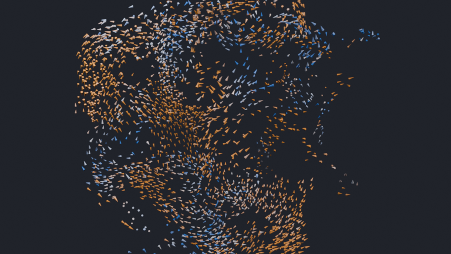
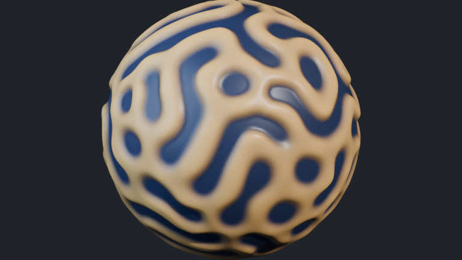
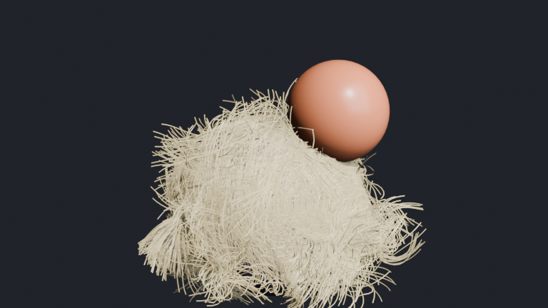
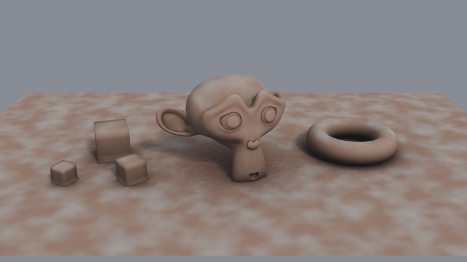
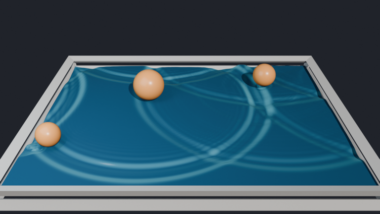
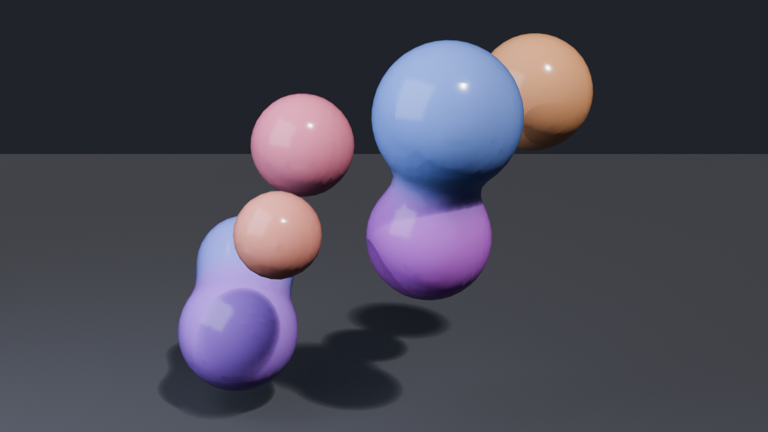
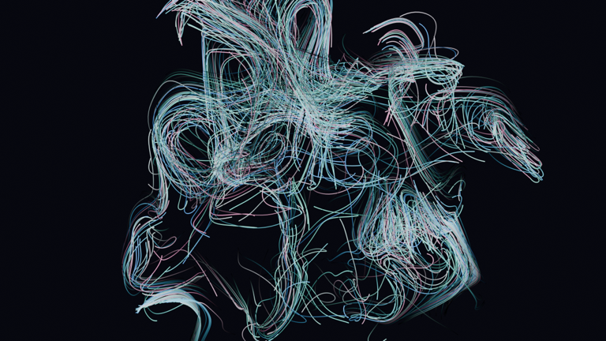
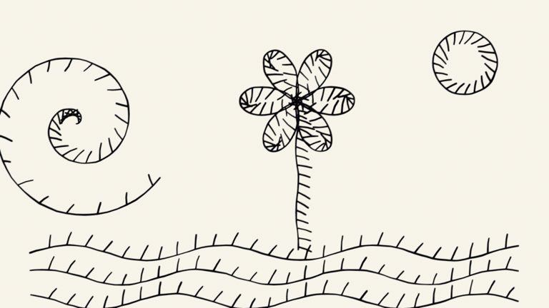
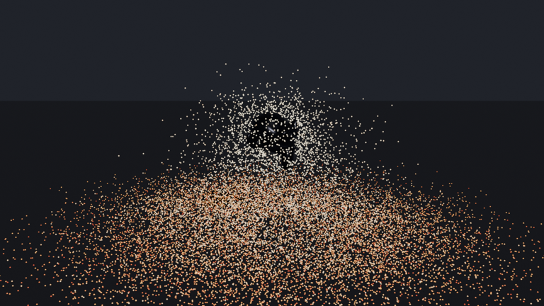
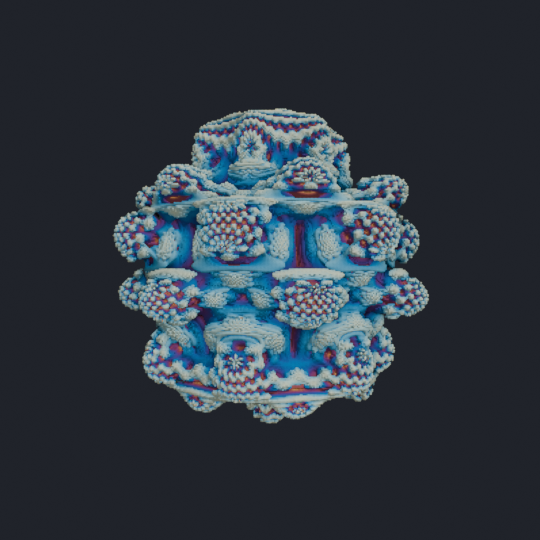

# Toast examples

Thirteen .blend files that show what Toast does, most of them inside Blender's Simulation Zones, and
how far it goes. Open one in the Toast build of Blender, allow Auto Run Python Scripts (or trust
the file), and press Play. Each file has a text named **README** with what to look at and what to
try. The Toast code is in the files as texts, and in [`src/`](src) for reading here.

| File | What it shows | Toast features |
| --- | --- | --- |
| [01_flocking](01_flocking.blend) | 3000 boids flying as a flock | Simulation Zone, `nearby_points`, `point_attr`, `curl_noise`, Run Over Instances writing `@transform` |
| [02_reaction_diffusion](02_reaction_diffusion.blend) | Gray-Scott patterns growing on a sphere | Repeat Zone inside a Simulation Zone (24 steps per frame), `point_neighbors`, `return` |
| [03_hair](03_hair.blend) | 4000 hair strands hit by a moving ball | Run Over Curves, lists as per-strand buffers, `curve_points`, `set_point_attr`, `closest_point` on Input 1, `output()` as a selection (Run Over Faces) |
| [04_differential_growth](04_differential_growth.blend) | A line that buckles into coral folds, written two ways side by side: one Geometry node, or a Points node for the heavy part + a Geometry node | Run Over Geometry in a Simulation Zone, rebuilding topology every step (`add_point`, `add_edge`, `remove_point`); splitting work between parallel and sequential nodes |
| [05_fluid](05_fluid.blend) | A dam break around an obstacle | Three chained Toast nodes in substeps, position-based fluid, walls as mirrored neighbors, collisions with a mesh on Input 1 that particles never cross |
| [06_mandelbulb](06_mandelbulb.blend) | A fractal ray-marched by 160000 points | Heavy per-element math, helpers, a library (`toast_lib.fractal`), `remove_point`, `output()` |
| [07_tree](07_tree.blend) | A tree that grows with the timeline | Run Over Geometry building a whole tree, lists as a stack, quaternions, a library (`toast_lib.tree`), `set_point_attr` on new points |
| [08_occlusion](08_occlusion.blend) | Ambient occlusion and dust, ray-traced on every point, every frame | `ray_cast` in a loop (48 rays per point) against the node's own geometry, Collection Info as the scene, `fbm` |
| [09_ripples](09_ripples.blend) | Balls dropping into and skimming over a pool | Wave equation with `point_neighbors` in substeps, `ray_cast` up into the balls (Input 1) to push the water down |
| [10_metaballs](10_metaballs.blend) | Blobs that melt together and apart | Marching cubes in Toast (Run Over Geometry): a 4096-entry table in a library, lists as layer caches so cubes share points, `add_point`/`add_face` building a closed mesh every frame |
| [11_trails](11_trails.blend) | Particles in a flow, each leaving a trail | Curves made by Toast: `add_point` + `add_curve` (Run Over Geometry), `extend_curve` and `remove_point` per curve each frame (Run Over Curves) in a Simulation Zone |
| [12_sketch](12_sketch.blend) | A Grease Pencil drawing that grows hairs and boils like hand-drawn animation | Toast on Grease Pencil: Run Over Geometry draws new strokes into each layer (`add_curve`), Run Over Points jitters every stroke point and its `@radius` |
| [13_fountain](13_fountain.blend) | Sparks born on a turning monkey, bouncing on the floor | Particles: emission with `random_surface_point` on Input 1 (Run Over Geometry), gravity, bounce and death by age (Run Over Points) in a Simulation Zone |
| [14_smoke](14_smoke.blend) | A plume of smoke rising and curling, in a grid that follows it | Volumes: Run Over Voxels, grids as `@density`/`@velocity`, `sample_grid` for advection, `grid_voxel` for neighbors, a pressure solve in a Repeat Zone, vorticity confinement, `activate_voxel`/`deactivate_voxel` so the grid follows the smoke; rendered in Cycles |

<p>
  
  
  
  
  
  
</p>
<p>
  
  
  
  
  
  
</p>
<p>
  
  
</p>

## How far it goes

Milliseconds per frame on a 16-core Linux machine (Threadripper 1950X, built-in compiler), simulation
included, measured with `run_examples.py` below. Default settings first, then scaled up.

| Example | Default | ms/frame | Scaled up | ms/frame |
| --- | --- | --- | --- | --- |
| Flocking | 3000 boids | 5 | 100000 boids | 30 |
| Reaction-diffusion | 40962 points x 24 steps | 5.5 | 163842 points x 24 steps | 13 |
| Hair | 4252 strands, 102000 points | 145 | 21237 strands, 510000 points | 208 |
| Differential growth, one core | 12000 points x 4 steps | 9 to 50 | 21600 points x 16 steps | 129 |
| Differential growth, all cores | 12000 points x 4 steps | 6 to 25 | 21600 points x 16 steps | 54 |
| Fluid | 11664 particles x 6 substeps | 126 | 50000 particles x 6 substeps | 208 |
| Mandelbulb | 400 x 400 rays | 31 | 1000 x 1000 rays | 195 |
| Tree | 4373 points | 2 | depth 9: 131000 mesh points | 12 |
| Ambient occlusion\* | 64317 points x 48 rays | 82 | 192 rays | 244 |
| Ripples\* | 76800 points x 4 steps | 3.7 | 750000 points x 4 steps | 13.5 |
| Metaballs\* | 8 balls, 56^3 cubes, one core | 3.5 | 60^3 cubes, lower threshold (bigger blobs) | 4.3 |
| Trails\* | 1200 curves x 48 points | 1.0 | 20000 curves x 120 points (2.4 million) | 12 |
| Fountain\* | 250 per frame, ~18000 alive | 1.1 | 4000 per frame, ~286000 alive | 3.1 |
| Smoke\* | voxels of 1/32 following the smoke, 28 passes per frame | 124 (170 at frame 200) | voxels of 1/64 (8 times as many) | 1440 (up to 3500) |

\* Measured on an Apple M3 Max (14 cores, built-in compiler) instead.

Toast runs the code once per point, curve or instance, in parallel, except with Run Over
Geometry, which runs it once, so on one core. The differential growth file shows the way around
that, with two objects that grow the same shape:

- **Growth (one core)**: `grow.py` does everything in Run Over Geometry: every point's neighbor
  search, then splitting long edges and rebuilding the loop. About 8 ms per step at 10800 points.
- **Growth (all cores)**: `move.py` (Run Over Points) does the neighbor search for every point in
  parallel and stores where it goes; `rebuild.py` (Run Over Geometry) only walks the loop to split
  and reconnect it. 1.5 ms for `move.py` + 3.4 ms for `rebuild.py` per step.

Keep only what must be sequential in Run Over Geometry. What's left here is rebuilding the mesh
every step, which a loop of points and edges needs as long as Toast can't insert a point into an
edge in place.

## Limits found while making these

- **A point from `add_point()` can't go in a list.** The tree keeps its stack of branch starts as
  point numbers instead: in a run, points from `point_count(0)` on are the new points in the order
  they're added, and `add_edge()` and `set_point_attr()` take those numbers.
- **Reading an attribute another node wrote needs its type.** `@previous` without an annotation is
  a float, so a vec3 written by an earlier node read wrong, silently. The node now warns about
  it and names the type (`fluid/relax.py` declares `@previous: vec3`).
- **Lists held up to 4096 values** when these were made (now 1048576, bigger ones on the heap), so
  the hair keeps 32 points per strand, the tree a stack of 512 branches, and the metaballs stop at
  60^3 cubes: a layer of 61 x 61 corners fit in a list, and the triangle table fills one exactly.
- **Run Over Geometry is sequential**, see above.
- **The smoke first filled a fixed box**, with its density faded near the walls and top so the
  box didn't show, and its code took the voxel size as a parameter. Now `@voxel_size`,
  `grid_voxel()` and `activate_voxel()`/`deactivate_voxel()` let the grid follow the smoke.
- **Reading a neighbor voxel was a call into the node** (about 15 ns): six neighbors per voxel
  per pass were most of the pressure solve's time. Reads one step from `@voxel` now read arrays
  (a pass of `pressure.py` on 262144 voxels: 2.2 ms before, 1.4 ms now).
- Blender renders curves only from Curves objects, not from mesh objects: the hair is a Curves
  object that reads the head's mesh.

## Building and measuring

The .blend files are made by a script, from the code in `src/`:

```sh
blender -b --factory-startup --python examples/build_examples.py            # all of them
blender -b --factory-startup --python examples/build_examples.py -- fluid   # one
```

`run_examples.py` plays a file forward, prints element counts and milliseconds per frame, and can
change node inputs (by node name or label) and render a still:

```sh
blender -b --enable-autoexec examples/05_fluid.blend --python examples/run_examples.py -- \
    --frames 40 --set "Points/Count=50000" --set "Seed/side=30" --render /tmp/fluid.png
```
