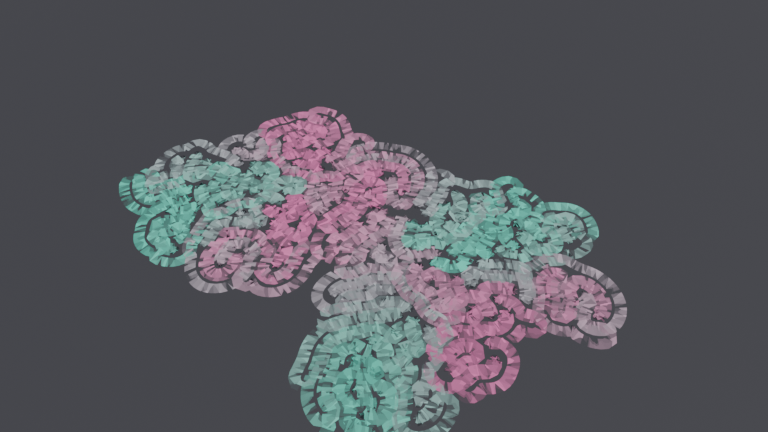
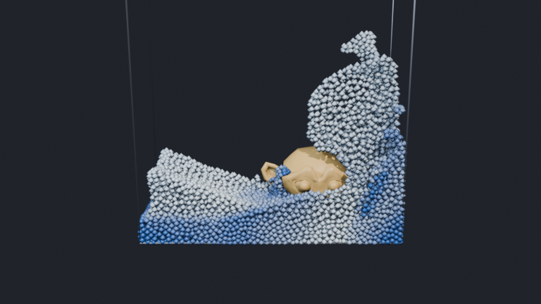
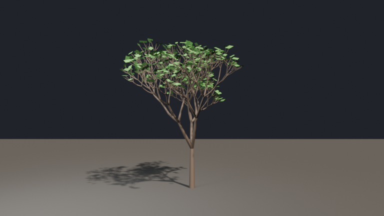

# Toast examples

Seven .blend files that show what Toast does, most of them inside Blender's Simulation Zones, and
how far it goes. Open one in the Toast build of Blender, allow Auto Run Python Scripts (or trust
the file), and press Play. Each file has a text named **README** with what to look at and what to
try. The Toast code is in the files as texts, and in [`src/`](src) for reading here.

| File | What it shows | Toast features |
| --- | --- | --- |
| [01_flocking](01_flocking.blend) | 3000 boids flying as a flock | Simulation Zone, `nearby_points`, `point_attr`, `curl_noise`, Run Over Instances writing `@transform` |
| [02_reaction_diffusion](02_reaction_diffusion.blend) | Gray-Scott patterns growing on a sphere | Repeat Zone inside a Simulation Zone (24 steps per frame), `point_neighbors`, `return` |
| [03_hair](03_hair.blend) | 4000 hair strands hit by a moving ball | Run Over Curves, lists as per-strand buffers, `curve_points`, `set_point_attr`, `closest_point` on Input 1, `output()` as a selection (Run Over Faces) |
| [04_differential_growth](04_differential_growth.blend) | A line that buckles into coral folds | Run Over Geometry in a Simulation Zone, rebuilding topology every step (`add_point`, `add_edge`, `remove_point`) |
| [05_fluid](05_fluid.blend) | A dam break around an obstacle | Three chained Toast nodes in substeps, position-based fluid, collisions with a mesh on Input 1 |
| [06_mandelbulb](06_mandelbulb.blend) | A fractal ray-marched by 160000 points | Heavy per-element math, helpers, a library (`toast_lib.fractal`), `remove_point`, `output()` |
| [07_tree](07_tree.blend) | A tree that grows with the timeline | Run Over Geometry building a whole tree, lists as a stack, quaternions, a library (`toast_lib.tree`), `set_point_attr` on new points |

<p>
  
  
  
  
  
  
</p>


## How far it goes

Milliseconds per frame on a 16-core Linux machine (Threadripper 1950X, built-in compiler), simulation
included, measured with `run_examples.py` below. Default settings first, then scaled up.

| Example | Default | ms/frame | Scaled up | ms/frame |
| --- | --- | --- | --- | --- |
| Flocking | 3000 boids | 5 | 100000 boids | 30 |
| Reaction-diffusion | 40962 points x 24 steps | 43 | 163842 points x 24 steps | 167 |
| Hair | 4252 strands, 102000 points | 145 | 21237 strands, 510000 points | 208 |
| Differential growth | grows to 12000 points, 4 steps | 9 to 50 | (one core, see below) | |
| Fluid | 11664 particles x 3 substeps | 52 | 50000 particles x 3 substeps | 87 |
| Mandelbulb | 400 x 400 rays | 31 | 1000 x 1000 rays | 195 |
| Tree | 4373 points | 2 | depth 9: 131000 mesh points | 12 |

Everything but the differential growth runs on all cores: one element per point, curve or
instance, in parallel. Run Over Geometry runs the code once, on one core, so the growth example
is the one to watch for a sequential limit: about 10 ms per step at 12000 points, each point
querying its neighbors.

## Limits found while making these

- **A point from `add_point()` can't go in a list.** The tree keeps its stack of branch starts as
  point numbers instead: in a run, points from `point_count(0)` on are the new points in the order
  they're added, and `add_edge()` and `set_point_attr()` take those numbers.
- **Reading an attribute another node wrote needs its type.** `@previous` without an annotation is
  a float, so a vec3 written by an earlier node read wrong, silently. The node now warns about
  it and names the type (`fluid/relax.py` declares `@previous: vec3`).
- **Lists hold up to 4096 values** and `nearby_points()` visits up to 4096 points. The hair keeps
  32 points per strand, the tree a stack of 512 branches.
- **Run Over Geometry is sequential**, see above.
- **Curves can't get new points** (only removed), so hair strands are made with Blender nodes and
  simulated with Toast.
- Blender renders curves only from Curves objects, not from mesh objects: the hair is a Curves
  object that reads the head's mesh.

## Building and measuring

The .blend files are made by a script, from the code in `src/`:

```sh
blender -b --factory-startup --python examples/build_examples.py            # all of them
blender -b --factory-startup --python examples/build_examples.py -- fluid   # one
```

`run_examples.py` plays a file forward, prints element counts and milliseconds per frame, and can
change node inputs (by node name or label) and render a still:

```sh
blender -b --enable-autoexec examples/05_fluid.blend --python examples/run_examples.py -- \
    --frames 40 --set "Points/Count=50000" --set "Seed/side=30" --render /tmp/fluid.png
```
